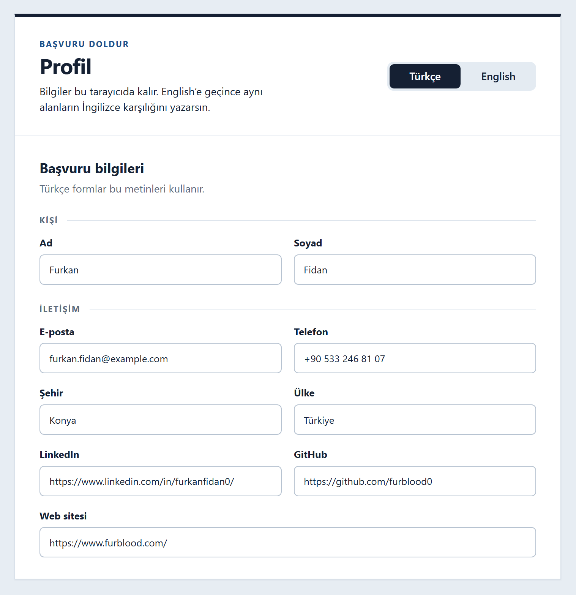
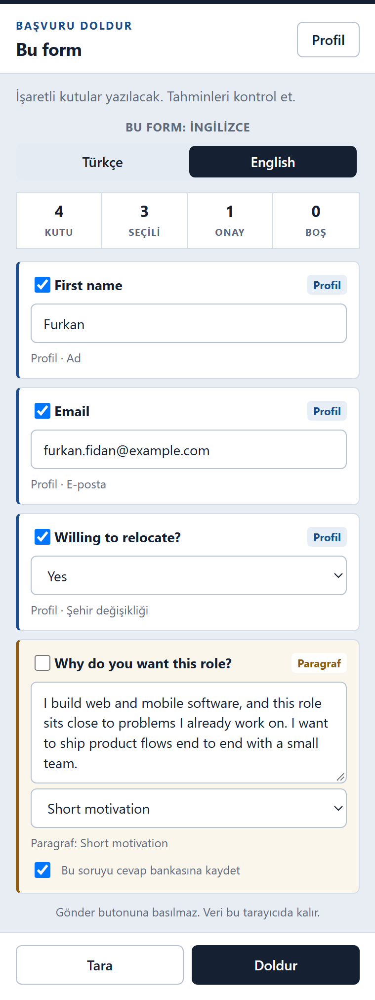

# Başvuru Doldur

İş başvurusu formundaki kutuları, tarayıcıda duran profilin ve daha önce verdiğin cevaplarla dolduran Chrome eklentisi. Gönder butonuna basmaz. Her seferinde tek bir formu doldurursun.

A Chrome extension that fills one job application from a profile kept on your computer. It works on Turkish and English forms, and it never submits the application.

<p align="center">
  
</p>
<p align="center">
  
</p>

Ekran görüntülerindeki e-posta ve telefon örnektir.

## Kurulum

1. Depoyu indir.
2. `chrome://extensions` adresini aç.
3. Geliştirici modunu aç.
4. **Paketlenmemiş öğe yükle** de, bu klasörü seç.
5. Araç çubuğundaki simgeye tıkla. Yan panel açılır. `Ctrl+Shift+Z` aynı paneli açar ve kapatır. Mac’te kısayol `Command+Shift+Z`. Kısayol `chrome://extensions/shortcuts` adresinden değişir.
6. **Profil**’den ad, iletişim ve tercihlerini kaydet.

Chrome 116 veya daha yeni bir sürüm gerekir.

## Kullanım

1. Başvuru formunun olduğu sekmeye geç.
2. **Tara**’ya bas. İlk seferde Chrome o site için izin ister. Emin olunan kutular işaretli gelir.
3. Tahminleri ve boş soruları kontrol et. Formun dili üstte yazar. Türkçe ve English düğmeleri, profilin hangi dildeki metninin kullanılacağını seçer.
4. **Doldur**’a bas.
5. Formu kendin gönder.

Bilmediği bir soruyu doldurursan ve **Bu soruyu cevap bankasına kaydet** işaretliyse, aynı soru sonraki formda hazır gelir. Uzun cevaplar için profildeki paragrafları kullan. Paragrafın etiketi soru metninde geçiyorsa önerilir.

Sayfada zaten dolu olan kutular varsayılan olarak işaretlenmez.

## Gizlilik

Profil, paragraflar ve cevap bankası `chrome.storage.local` içindedir. Bir sunucuya gitmez. Eklenti sayfayı yalnızca **Tara** ya da **Doldur**’a bastığında okur. İzin, site site istenir. İzin verilmiş bir site bir daha sorulmaz.

Profil sayfasında Türkçe veya English seçilir. Ad, e-posta, telefon ve bağlantılar ortaktır. Ülke, ünvan, okul ve bölüm her dilde ayrı yazılır. Çalışma tercihi, derece, başlangıç ve şehir değişikliği seçilerek kaydedilir. Formun diline göre etiketi yazılır.

## Sınırlar

- Başka bir alan adından gömülen formlar okunamaz.
- Kapalı shadow DOM okunamaz.
- Kapalı akordeonun içindeki kutular, açıp yeniden tarayana kadar görünmez.
- Çoklu seçim listeleri elle işaretlenir.
- Dosya yükleme kutularına CV bırakılmaz.
- Bazı siteler seçimi kendi menüsünde tutar. Kutuya yazılan değer menüde seçilmiş sayılmayabilir.

## Geliştirme

Derleme adımı yok. Kaynak düz JavaScript’tir.

```
node test/match.test.js
```

## Lisans

[MIT](LICENSE)
